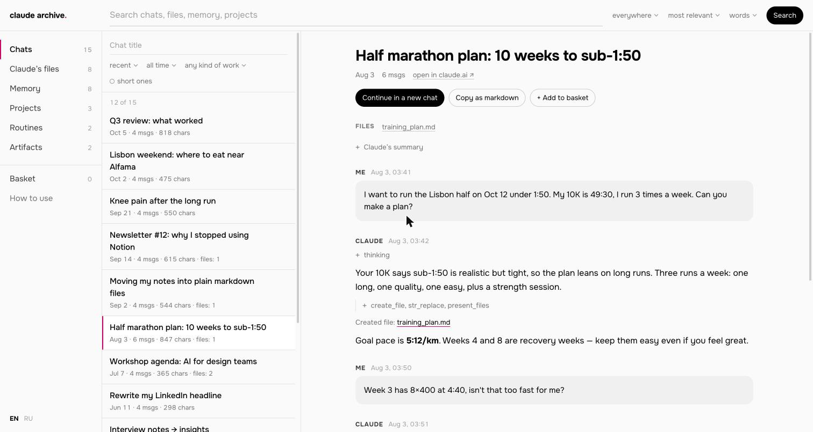
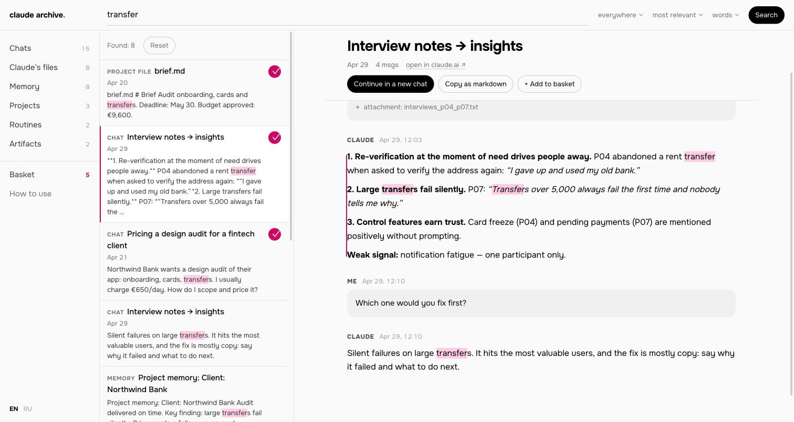
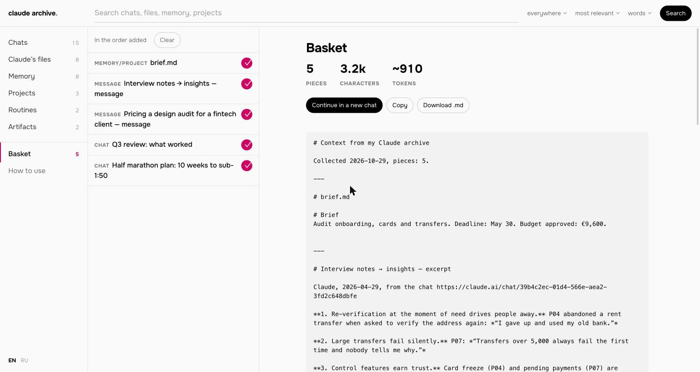

# Claude Export Viewer

**Read, search and carry over your claude.ai history — locally, from the official data export.**

[Русская версия](README.ru.md)



## Why this exists

A lot of work now lives inside a claude.ai account: hundreds of chats, project instructions and files, what Claude remembers about you, documents and pages it made for you. If you lose access to the account — a suspension, a payment problem, an email you no longer control — all of that goes with it.

Anthropic gives you a way out, but it's rough:

- **The export is made for machines.** Settings → Privacy → Export data sends you a set of zip files. Inside are JSON files; `conversations.json` alone can be hundreds of megabytes. You can't read it, and you can't search it.
- **It can't be imported anywhere.** Exported data [can't be imported into another personal Claude account](https://support.claude.com/en/articles/9450526-export-your-claude-data), and there is no migration between personal accounts.
- **Even a banned account can export.** Free, Pro and Max users whose account was banned [can still sign in to export their data](https://support.claude.com/en/articles/8241253-safeguards-warnings-and-appeals), though what's available may be restricted. So the export is often the last copy you get.

This tool turns that export into an archive you can browse, search and pull pieces out of — so the context you built up can move to a new account, to Claude Code, or to another assistant.

## What it does

- **Browse everything in the export:** chats, files Claude made, memory, projects, routines and artifacts.
- **Search across all of it** by words or with regular expressions. Clicking a result opens the chat right at that message.
- **Rebuild the files Claude made in your chats.** Reports, plans, code and pages, with Claude's later edits applied.
- **Collect a basket.** Press **+** on chats, single messages, files, memory or projects. The basket becomes one markdown file you can paste into a new project, a `CLAUDE.md`, or hand to another assistant.
- **Continue an old conversation in a new chat.** Claude or ChatGPT, any length: the conversation moves as a file.
- **Write everything useful out as `.md`** with `--dump`: memory, projects, routines and Claude's files, in folders.
- **English and Russian interface.** Picked from your browser, switchable in the sidebar.





## Quick start

You need Python 3.9 or newer. Macs usually have it; on Windows, install it from [python.org](https://www.python.org/downloads/). Nothing else to install.

1. **Export your data.** On claude.ai or in Claude Desktop: Settings → Privacy → Export data. When the email arrives, download every zip from it while signed in. The links work only in a browser where you're logged in, and only for 24 hours. Leave the zips in your Downloads folder, or put them together in one folder inside Downloads. No need to unpack them.
2. **Get the viewer.** Click **Code → Download ZIP** on this page and unpack it.
3. **Open it:**
   - **Mac:** double-click `Open Claude Archive.command`. The first time, macOS will block it: right-click the file → **Open** → **Open**. If no export is found in Downloads, a folder picker opens.
   - **Windows:** double-click `Open Claude Archive.bat`.
   - **Terminal:** `python3 viewer.py` (it looks in Downloads), or `python3 viewer.py "path/to/export"`.

Your browser opens the archive. The first start indexes the export: about ten seconds for 1,400 chats.

**Just want to look first?** A fictional demo export is included:

```bash
python3 viewer.py demo/claude-export-demo
```

## Carrying your context over

The export is raw material. What's worth moving is much smaller:

1. **Start with memory.** It's already a summary Claude made about you: profile, preferences, projects. Read it before you trust it — some entries are Claude's guesses (marked `[inferred]`), and some will be out of date.
2. **Then projects.** Their instructions and files are your working setups.
3. **Then search chats by topic** and drop the useful messages into the basket. Decisions, prompts that worked, final versions of texts — not the back-and-forth that led to them.
4. **Put the result in files you control:** a `CLAUDE.md` for Claude Code, `AGENTS.md` for other agents, project instructions in a new account. Keep those files in a folder synced to a private git repo, and the next lost account costs you an evening, not a year.

`python3 viewer.py --dump` writes memory, projects, routines and Claude's files out as markdown into `claude-export-md/` inside the export folder, a good starting point for the step above.

## What the export doesn't have

- **Skills** you uploaded to claude.ai aren't in it. Keep their source folders yourself.
- **Files Claude wrote through the terminal** (`cat > file`) can't be rebuilt; only the command is visible.
- **Which project a chat belongs to** isn't recorded in `conversations.json`.
- If one of Claude's edits to a file didn't match, the file shows a warning: that version may differ from the final one.

## Privacy

Everything runs on your computer. The server listens only on `127.0.0.1`, and the index (`claude-export-viewer.db`) is saved next to your export. The page loads two open-source libraries (marked, DOMPurify) from jsdelivr and a font from Google Fonts; your data isn't sent anywhere. The basket and language choice live in your browser's local storage.

Pages Claude made are shown in a sandbox, so their scripts can't reach the rest of the archive.

## Command line

```
python3 viewer.py [export_folder] [--port 8765] [--rebuild] [--dump] [--no-browser]
```

- `export_folder` — optional; without it the viewer looks in `~/Downloads`.
- `--rebuild` — rebuild the index (for example after downloading a fresh export into the same folder).
- `--dump` — write memory, projects, routines and Claude's files as markdown and exit.

The demo export is generated by `demo/make_demo.py`.

---

Not affiliated with Anthropic. "Claude" is a trademark of Anthropic, PBC.

Built by Claude Code for Nailia · [nailia.work](https://nailia.work) · MIT License
