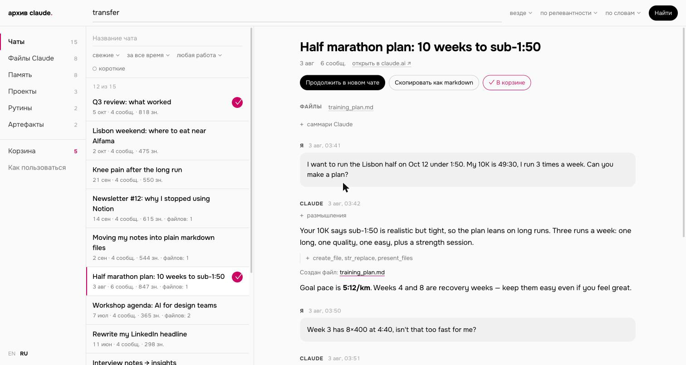
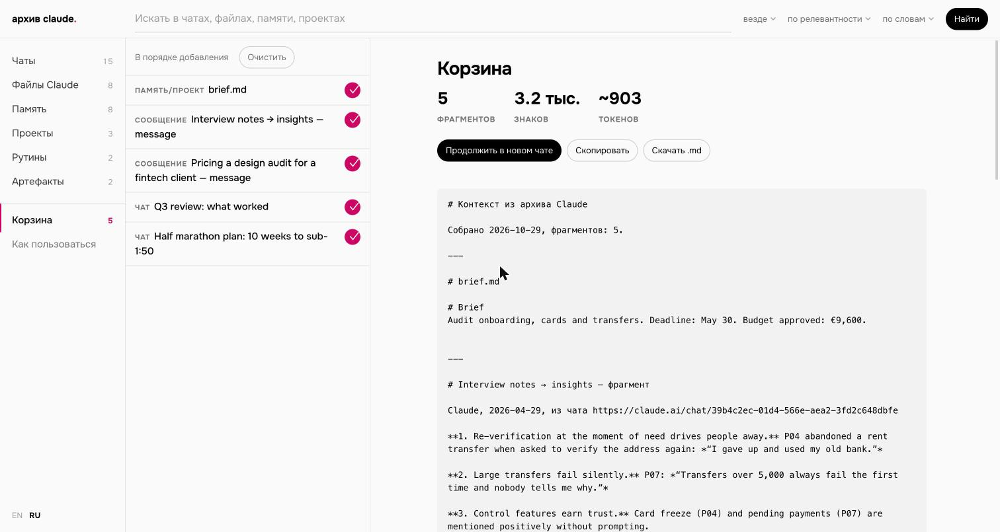

# Claude Export Viewer

**Читать, искать и переносить историю из claude.ai — у себя на компьютере, из официального экспорта данных.**

[English version](README.md)



## Зачем это

Внутри аккаунта claude.ai теперь живет много работы: сотни чатов, инструкции и файлы проектов, то, что Claude запомнил о вас, документы и страницы, которые он сделал. Если доступ к аккаунту пропадет — блокировка, проблема с оплатой, почта, к которой больше нет доступа, — все это уйдет вместе с ним.

У Anthropic есть выход, но неудобный:

- **Экспорт сделан для программ, а не для людей.** Settings → Privacy → Export data присылает набор zip-архивов. Внутри JSON, и один `conversations.json` может весить сотни мегабайт. Прочитать его глазами нельзя, искать по нему тоже.
- **Его некуда загрузить.** Экспорт [нельзя импортировать в другой личный аккаунт Claude](https://support.claude.com/en/articles/9450526-export-your-claude-data), переноса между личными аккаунтами нет.
- **Даже заблокированный аккаунт может сделать экспорт.** Пользователи Free, Pro и Max после блокировки [могут войти и выгрузить данные](https://support.claude.com/en/articles/8241253-safeguards-warnings-and-appeals), хотя часть данных может быть недоступна. Часто экспорт — это последняя копия.

Этот инструмент превращает экспорт в архив, по которому можно ходить, искать и вытаскивать нужное. Так накопленный контекст переезжает в новый аккаунт, в Claude Code или к другому ассистенту.

## Что умеет

- **Показывает все, что есть в экспорте:** чаты, файлы Claude, память, проекты, рутины и артефакты.
- **Ищет по всему сразу**, по словам или регулярными выражениями. Клик по результату открывает чат прямо на нужном сообщении.
- **Восстанавливает файлы, которые Claude делал в чатах.** Отчеты, планы, код и страницы, с учетом его последующих правок.
- **Собирает корзину.** Плюсик у чатов, отдельных сообщений, файлов, памяти и проектов. Корзина превращается в один markdown-файл для нового проекта, `CLAUDE.md` или другого ассистента.
- **Продолжает старый разговор в новом чате** Claude или ChatGPT, любой длины: разговор переезжает файлом.
- **Выкладывает все полезное в `.md`** командой `--dump`: память, проекты, рутины и файлы Claude по папкам.
- **Интерфейс на русском и английском.** Язык берется из браузера и переключается внизу меню.



## Как запустить

Нужен Python 3.9 или новее. На маке он обычно уже есть, на Windows его ставят с [python.org](https://www.python.org/downloads/). Больше ничего устанавливать не надо.

1. **Сделайте экспорт.** В claude.ai или Claude Desktop: Settings → Privacy → Export data. Когда придет письмо, скачайте все zip-архивы из него, не выходя из аккаунта: ссылки работают только в браузере, где вы залогинены, и только сутки. Оставьте архивы в Загрузках или сложите в одну папку внутри Загрузок. Распаковывать не нужно.
2. **Скачайте просмотрщик.** На этой странице **Code → Download ZIP**, распакуйте.
3. **Откройте:**
   - **Mac:** двойной клик по `Open Claude Archive.command`. В первый раз macOS его заблокирует: правый клик по файлу → **Открыть** → **Открыть**. Если экспорт не найдется в Загрузках, откроется окно выбора папки.
   - **Windows:** двойной клик по `Open Claude Archive.bat`.
   - **Терминал:** `python3 viewer.py` (сам ищет в Загрузках) или `python3 viewer.py "путь/к/экспорту"`.

Браузер откроет архив. При первом запуске экспорт индексируется. У меня экспорт на 1400 чатов (615 МБ) проиндексировался за 10 секунд.

**Хотите сначала посмотреть?** В репозитории есть выдуманный демо-экспорт:

```bash
python3 viewer.py demo/claude-export-demo
```

## Как перенести контекст

Экспорт — это сырье. То, что стоит переносить, намного меньше:

1. **Начните с памяти.** Это уже выжимка, которую Claude сделал о вас: профиль, предпочтения, проекты. Прочитайте ее, прежде чем доверять: часть пунктов — догадки Claude (помечены `[inferred]`), часть устарела.
2. **Потом проекты.** Их инструкции и файлы — это ваши рабочие настройки.
3. **Потом ищите по чатам по темам** и складывайте полезные сообщения в корзину. Решения, удачные промпты, финальные версии текстов — а не переписку, которая к ним привела.
4. **Положите результат в файлы, которые принадлежат вам:** `CLAUDE.md` для Claude Code, `AGENTS.md` для других агентов, инструкции проектов в новом аккаунте. Держите эти файлы в папке с синхронизацией в приватный git-репозиторий, и следующая потеря аккаунта будет стоить вечер, а не год.

`python3 viewer.py --dump` выкладывает память, проекты, рутины и файлы Claude в markdown в папку `claude-export-md/` внутри экспорта. С этого удобно начинать.

## Чего нет в экспорте

- **Скиллов**, загруженных в claude.ai. Храните их исходники у себя.
- **Файлов, которые Claude писал через терминал** (`cat > file`): восстановить их нельзя, видна только команда.
- **Привязки чатов к проектам:** в `conversations.json` ее нет.
- Если какая-то правка Claude к файлу не совпала, у файла стоит предупреждение: версия может отличаться от финальной.

## Приватность

Все работает на вашем компьютере. Сервер слушает только `127.0.0.1`, индекс (`claude-export-viewer.db`) лежит рядом с экспортом. Страница подгружает две открытые библиотеки (marked, DOMPurify) с jsdelivr и шрифт с Google Fonts, ваши данные никуда не отправляются. Корзина и выбор языка хранятся в браузере.

Страницы, которые сделал Claude, открываются в песочнице, и их скрипты не видят остальной архив.

## Командная строка

```
python3 viewer.py [папка_экспорта] [--port 8765] [--rebuild] [--dump] [--no-browser]
```

- `папка_экспорта` — необязательно, без нее просмотрщик ищет в `~/Downloads`.
- `--rebuild` — пересобрать индекс (например, если скачали свежий экспорт в ту же папку).
- `--dump` — выложить память, проекты, рутины и файлы Claude в markdown и выйти.

Демо-экспорт собирается скриптом `demo/make_demo.py`.

---

Не связан с Anthropic. «Claude» — товарный знак Anthropic, PBC.

Собрано Claude Code у Наили · [nailia.work](https://nailia.work) · лицензия MIT
